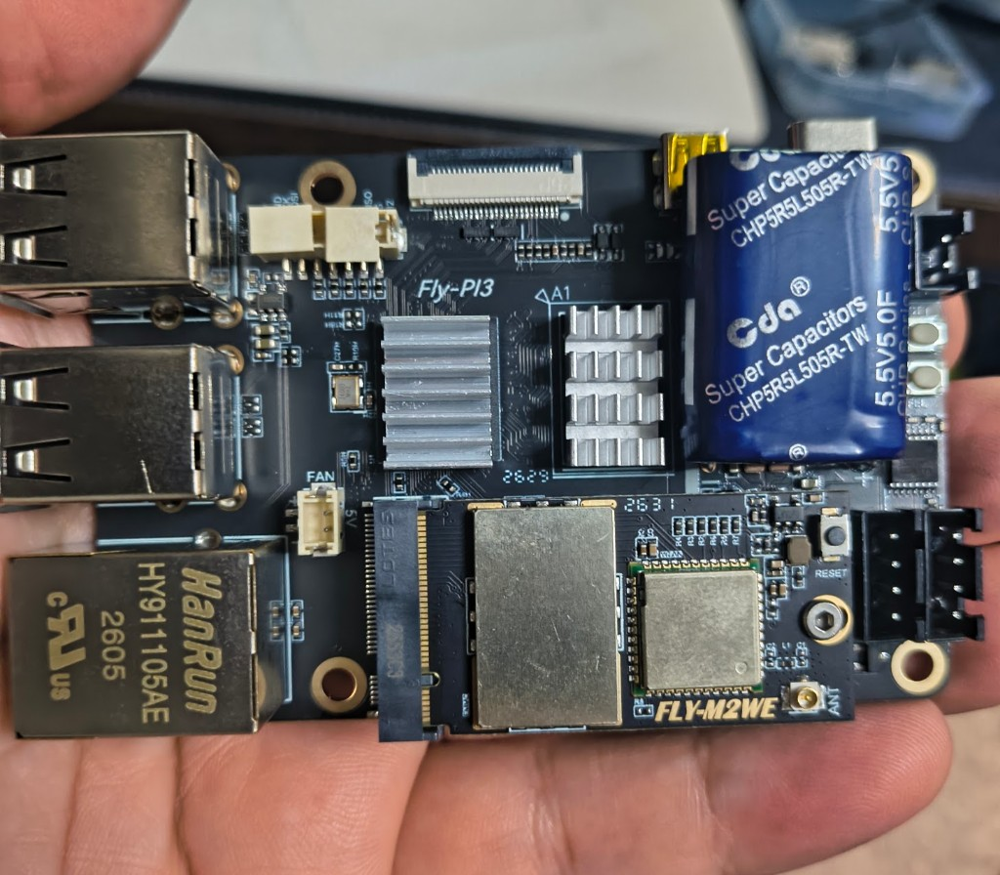

# Fly Pi V3 — board README



**Status:** Supported — public **1.05** (GitHub Release [v1.05-pi-v3](https://github.com/0dysseusRex/fly-bian/releases/tag/v1.05-pi-v3)). Product version is independent of Lite (Lite is 1.06). **1.0** remains at [v1.0-pi-v3](https://github.com/0dysseusRex/fly-bian/releases/tag/v1.0-pi-v3).  
**Vendor docs:** [FLY-Pi V3 Host Board](https://mellow.klipper.cn/en/docs/ProductDoc/SBC/fly-pi-v3/) · [FlyOS-FAST intro](https://mellow.klipper.cn/en/docs/ProductDoc/SBC/fly-pi-v3/host/)  
**Armbian boards:** `fly-pi-v3`, `fly-pi-v3-simpleaf`, `fly-pi-v3-kiauh`  
**DTB:** `fly-h618.dtb` (captured from FlyOS-FAST H618 v1.4.0 on M2WS)  
**Kernel:** **6.12.114** `legacy-sunxi64` with `drv-mmc-sunxi-one-xfer`  
**OEM OS:** FlyOS-FAST **H618** image, `board=fly-pi-v3`  
**Swap:** **512 MiB** `fly-swapfile` after first-boot resize  

Unofficial Debian/Armbian for this PCB — **not FlyOS**. Do **not** flash Fly-Lite-2.1 (H3) images onto a Pi V3. Leftover lab gaps: [untested.md](untested.md).

Current files from [v1.05-pi-v3](https://github.com/0dysseusRex/fly-bian/releases/tag/v1.05-pi-v3):

- `Fly-bian-1.05_Fly-Pi-V3_Base.img.xz`
- `Fly-bian-1.05_Fly-Pi-V3_Simple-AF-ea7125a.img.xz`
- `Fly-bian-1.05_Fly-Pi-V3_KIAUH-v6.3.2.img.xz`

Flash flow: [Getting started](../../wiki/Getting-Started.md) — burn MicroSD or M2WE eMMC → `FLY-SETUP` / wizard → SSH → `fly-start` or `fly-kiauh`.

---

## Hardware overview

From Mellow product docs (confirm pinmux on a live board / vendor DTB before overlays).

| Item | Detail |
| --- | --- |
| Form factor | Raspberry Pi–compatible standard-size host |
| SoC | Allwinner **H618**, quad **Cortex-A53** 64-bit |
| GPU | Arm **Mali-G31 MP2** |
| RAM | **1 GB DDR4** |
| Storage (as shipped) | **None** — must add onboard **MicroSD** and/or an official FLY **M2** module (see below) |
| MicroSD (onboard reader) | TF slot, up to **128 GB** — optional bulk store for **gcode** + **timelapse** (see storage policy) |
| M2 connector | Onboard **FLY private** socket — **official FLY modules only** (standard M.2 will damage the board) |
| Onboard Wi-Fi | **No** — Wi-Fi comes from an M2 module (or USB Wi-Fi) |
| Ethernet | **100 Mb** Eth x1 |
| USB | **USB 2.0 x4** |
| Display | **Micro HDMI** x1; **FPC-HDMI** x1 (25P reverse 0.5 mm); **FPC-TFT** x1 (**16P** reverse 0.5 mm — V3 requires 16P) |
| UART | **XH2.54-4P** x1 (external serial screens / UART) |
| SPI / RRF | **ZH1.5-7P** multiplexed (ADXL345 / RRF) — **shares SPI with FPC-TFT; do not use both** |
| RS232 | **XH2.54-4P** x2 (toolboards; common ground required) |
| Power | **DC 12–24 V** (`XH2.54-2P`) **or** Type-C **5 V / ≥2 A** (choose one) |
| Fan | **ZH1.5-2P** always-on 5 V (**no PWM**) |
| Power-loss HW | Supports print recovery + safe shutdown (OS config; **off by default**) |
| Lab silkscreen | **Fly-PI3**; FAN; RESET; FLY-M2WE + ANT; supercap module on some units |

### FLY M2 modules (three supported configs)

All use the same private FLY M2 socket. Fly-bian images must boot and run with **any** of these (and with **no** M2 module + Ethernet-only).

| Module | Radio | On-module storage | Notes |
| --- | --- | --- | --- |
| **M2 2.4G Wi-Fi** (Wi-Fi-only) | **2.4 GHz only** | None | Cheap Wi-Fi add-on; OS/rootfs still on onboard MicroSD (or other boot media) |
| **M2WE** | **2.4 + 5 GHz** | **16 GB eMMC** | Can hold/boot the system image; IPEX1 antenna. OEM often ships FlyOS on the eMMC |
| **M2WS** | **2.4 + 5 GHz** | **16 GB soldered TF** (module-local card, not the board slot) | Same H618 image family; USB gadget exposes boot+FlyOS-Conf+rootfs_A. DTB radio name **`rtl8821cs`** (see artifacts) |

**Fly-bian requirement:** one image family must work for:

1. Onboard MicroSD only (no M2) — **proven on 1.05**  
2. Onboard MicroSD + Wi-Fi-only M2 — 2.4 GHz-only module not on the bench  
3. M2WE eMMC boot (± onboard MicroSD present) — **proven on 1.05**  
4. M2WS module TF boot (± onboard MicroSD present) — not labbed yet  

Linux `mmcblk` numbering depends on which hosts bind. On **1.05**:

| Layout | Typical nodes |
| --- | --- |
| Onboard MicroSD only | `mmcblk0` = the TF card (`FLY-SETUP` + `armbi_root`) |
| M2WE eMMC, no card in the TF slot | `mmcblk1` = eMMC |
| M2WE eMMC + onboard TF seated | `mmcblk0` = TF slot, `mmcblk1` = eMMC |

U-Boot still numbers the TF slot as MMC0 and the eMMC as MMC1. SPL “Trying to boot from MMC2” is the eMMC.

**Wi-Fi band is a property of the module, not of the image.** The 2.4 GHz-only M2 has no 5 GHz radio. M2WE and M2WS do both. First boot must associate on 2.4 GHz for every module, and on 5 GHz when the module actually has that band. The lab AIC8800D80 path (5 GHz) does not cover the 2.4-only module. That module is not on the bench yet: `fly-apply` prints any other SDIO id and leaves the radio down, and the 2.4-only boot is tested when the module arrives.

### Choosing boot media

Flash Fly-bian onto **one** medium. Do not flash the image onto both the onboard MicroSD and the M2 eMMC (or the M2WS module TF). U-Boot can load the kernel from one while the root UUID matches the other, and the board comes up as a mix of the two installs.

| You want to boot from | Do this | First run |
| --- | --- | --- |
| **M2WE eMMC** (typical) | Write the image to the module eMMC. Leave factory FlyOS only if you still want FlyOS. | SPL prefers the module (`Trying to boot from MMC2`). Root resizes on the 16 GB chip, a 512 MiB swapfile is created, then **Boot Complete**. Several minutes; quiet stretches are normal. |
| **M2WS module TF** | Same image family, written to the module card. | Same first-boot work as eMMC. |
| **Onboard MicroSD** | Write the image to the TF card. **Remove or blank** the M2 storage first. If FlyOS is still on the eMMC, the board boots FlyOS and ignores the card you just flashed. | **1.05** turns overlay `fly-pi-v3-sd` on so Linux can see the slot. Root resizes to the card. Stock **1.0** leaves that node off: SD-only hangs in initramfs waiting for the root UUID. |

A second card or USB drive may hold gcode and timelapse (below). It must **not** also contain this image.

Ethernet is the easy first network. Wi-Fi needs an official M2 module and its antenna. Soft `reboot` often hangs after `[ OK ]` — power-cycle.

### Extra storage (Pi V3 only)

`fly-media-sd` ships only on Fly Pi V3 images. Lite does not have it.

**Default:** OS, gcode, and timelapse stay on the boot medium.

**Optional:** bind-mount `gcodes`, `timelapse`, and `frames` over `~/printer_data`. Moonraker/Fluidd/Mainsail paths do not change.

| OS is on | Extra storage is | Notes |
| --- | --- | --- |
| M2WE eMMC or M2WS | Second card in the **onboard TF slot** | Do not flash Fly-bian onto that extra card. |
| Onboard MicroSD | One **USB flash drive**, or a MicroSD in a **USB reader** | Plug only one extra USB disk. |

```bash
sudo fly-media-sd status
sudo fly-media-sd enable          # prompts before formatting a blank card or USB drive
sudo fly-media-sd enable --format # wipe the extra media and use it
sudo fly-media-sd disable         # stop bind-mounts; files stay on the card or USB drive
```

The helper refuses the boot disk and anything that looks like Fly-bian/FlyOS (`FLY-SETUP` + `armbi_root`). Extra bind mounts stay opt-in.

**Do not unplug extra storage while it is enabled.** Run `sudo fly-media-sd disable` first, then pull the card or USB drive. Unplugging while enabled leaves `~/printer_data` on the boot disk until the media is back, and risks a dirty filesystem.

**1.0:** extra TF storage needs the OS on M2, and SD-only boot needs overlay `fly-pi-v3-sd` copied onto `FLY-SETUP` before the first power-on. **1.05** loads that overlay by default.

### Connectors (practical)

- **No factory storage** — need onboard MicroSD and/or an official M2 module before first boot.
- **M2 socket** — private FLY protocol only; never insert a normal NVMe/M.2 card.
- **FPC-TFT** — 16P reverse cable; conflicts with **SPI/RRF** accelerometer header.
- **Ethernet** is the easy first-network path (Wi-Fi is optional hardware).
- Power from **either** 12–24 V terminal **or** Type-C 5 V — not both paths as a mixed design assumption until verified.

### Power and reset behavior

- Soft `reboot` often hangs after `[ OK ]` on Fly-bian; use a 5 V (or 12–24 V) power cycle. Do not pulse DTR/RTS.
- Power-loss features need OS enablement; factory default disabled.

---

## OEM FlyOS-FAST (software map)

Pi V3 uses the **H618** FlyOS-FAST image family (with FLY-C5 / C8P). **Do not** flash H3 (Lite) or H5 (older Pi/Gemini) images.

| Area | OEM behavior |
| --- | --- |
| OS | FlyOS-FAST — SquashFS **A/B** slots, OTA slot switch |
| Config partition | **FlyOS-Conf** on TF: `config.txt` for board / network / screen / print mode without entering Linux |
| Persistence | Separate data partition for `/etc`, `/data`, `/root`, print-mode data |
| Packages | **No apt/dpkg** — update via OTA / USB / full reflash only |
| Account | **`root`** interactive management account |
| Print mode | `printer=klipper` **or** `rrf` (not both) |
| Web UI | `klipper_webui=fluidd` (default) or `mainsail` |
| Local UI | KlipperScreen / FLY Screen optional; off by default; pick one |
| Displays | HDMI, FLY-TFT, USB screens, serial (**Moon2UART**) |
| Camera | Crowsnest opt-in; v1.4.0 also **GoCam** (mutually exclusive with Crowsnest) |
| Network | Wired + Wi-Fi + SSH; from v1.3.9 Eth auto-detects PC-direct vs router |
| Board key | **`board=fly-pi-v3`** (drives UART/SPI/screen) |
| Host role | Standalone host — **external** printer MCU flashed separately (unlike C5/C8P onboard MCU maintain) |
| Bundled stack | Klipper, Moonraker, Fluidd/Mainsail, numpy / input-shaping helpers, Katapult + MCU FW packs |
| Docs baseline | Common features verified on **v1.3.10**; **v1.4.0** current release line |

### `config.txt` controls (confirmed from host docs)

| Key / area | Purpose |
| --- | --- |
| `board=fly-pi-v3` | Device model / pinmux profile |
| `printer=` | `klipper` or `rrf` |
| `klipper_webui=` | `fluidd` or `mainsail` |
| Screen / KS / FLY Screen | Enable local UI + type/orientation (platform-specific values) |
| Moon2UART | Serial screen device + baud |
| Crowsnest / GoCam | Camera stack (defaults off; exclusive) |
| Network / SSH / Wi-Fi | Pre-configure without login |
| Power-loss options | Enable recovery / safe shutdown when desired |

Captured from M2WS USB gadget (H618 v1.4.0): see [`flyos-artifacts/live/m2ws-usb-pull/`](../../../flyos-artifacts/live/m2ws-usb-pull/REPORT.md). Still set `board=fly-pi-v3` when the module is seated on a Pi V3 (stick was left at `board=none`).

### FlyOS pull highlights (M2WS / H618 v1.4.0)

| Item | Value |
| --- | --- |
| Image | FlyOS-FAST H618 **v1.4.0-g8b2869b1d9** |
| DTB | `fly-h618.dtb`; overlays prefix `sun50i-h616` |
| Kernel | **6.6.75** |
| Console | **`ttyS0`, 115200** |
| MMC0 / MMC1 / MMC2 | MicroSD / SDIO Wi-Fi (`wifi@1`) / eMMC |
| Wi-Fi (DTB) | **`rtl8821cs`** — modules `rtw88_8821cs` + `rtw88_sdio`; firmware `rtw88/rtw8821c_fw.bin` |
| Also shipped | **AIC8800** firmware + `.ko` (other M2/USB radios) |
| `board=fly-pi-v3` | Enables **spidev1.2** (`spi@5011000/spidev@2`) |
| TFT | `pitft@0` / `mellow,fly-tft-v2` on same SPI1; mutex with spidev1.0/1.1 |
| Rootfs | SquashFS A/B (`p3` / `p5`); USB gadget only exposes A |

---

## Boot / firmware map (Fly-bian 1.05)

| Piece | Role |
| --- | --- |
| U-Boot / DTB | Captured **`fly-h618.dtb`**. Do not reuse Lite H3 overlays |
| User overlays (default) | `fly-pi-v3-sd` `fly-pi-v3-tft` `fly-pi-v3-tft-c` `fly-pi-v3-uart1` `fly-pi-v3-usb1` `fly-pi-v3-rs232`. `fly-apply` keeps `fly-pi-v3-sd` |
| Console | `console=serial`, Type-C CH340 `ttyS0` @ **115200**. Do not pulse DTR/RTS. Type-C musb gadget stays disabled |
| Network | Ethernet first; M2 SDIO Wi-Fi second (lab M2WE is **AIC8800**, vendor `0xc8a1`). 2.4 GHz-only M2 not labbed |
| Storage | SD-only and M2WE eMMC first boot proven. Optional gcode/timelapse via `fly-media-sd` (Pi V3 only) |
| MMC | One DMA transfer at a time across SD, eMMC, and SDIO Wi-Fi (`drv-mmc-sunxi-one-xfer`) |
| Swap | **512 MiB** after resize |
| udev | `systemd-udev-trigger` stays **masked**. Do not unmask it |

First-boot FAT volume label: **`FLY-SETUP`**. `SERIAL_CONSOLE=Yes` keeps the Type-C login.

---

## Displays

- **FPC-HDMI (Fly HDMI cable)** — proven 800×480. GrumpyScreen paints `/dev/fb0` here plus USB touch. `fly-grumpy-evdev.sh` gives the `fly` user access while udev-trigger stays masked.
- **Micro HDMI jack** — same transmitter; the connector itself has not been plugged into a monitor.
- **FPC-TFT** — 16P reverse; SPI1. Cap overlay `fly-pi-v3-tft-c` (GT911) is default-on. The SPI panel is `/dev/fb1` and stays blank for GrumpyScreen. **Do not** use the TFT and the ZH1.5-7P ADXL/RRF header together. `SPI_DEVICE=adxl` in `fly-start.txt` switches to that header on the next boot; unplug the panel first.

---

## Memory

**1 GB DDR4** plus a **512 MiB** swapfile after first-boot resize. Healthier than Lite 512 MB; still avoid stacking every Moonraker companion + KlipperScreen + cams blindly. Add an `oom.md` only if lab shows the same failure modes.

---

## Serial console

| Setting | Value |
| --- | --- |
| OEM Type-C | Mellow [Basic Tutorial](https://mellow.klipper.cn/en/docs/DebugDoc/BasicTutorial/): Type-C data cable → Windows **CH340** COM @ **115200** |
| Lab FlyOS (working) | Type-C **does** enumerate **CH340** `VID_1A86&PID_7523` → COM4 @ **115200**. Console shows boot + bilingual “Press ENTER twice to login as root”. Hold DTR/RTS idle; do not pulse |
| Lab Fly-bian 1.05 | Same cable/board: Type-C **does** enumerate CH340 @ **115200**. COM port is often phantom until the board has 5 V |
| UART header | TTL UART is **`ttyS1` @ 115200** on XH2.54-4P (tested). Type-C console is **`ttyS0`** |
| Moon2UART | OEM default `/dev/ttyS1` @ 115200 (`config.txt`) |
| HDMI | Micro HDMI + FPC-HDMI. Fly-bian keeps `console=serial` (Type-C). Do not enable both TFT CSs with ADXL |
| USB-A | Four hosts via `fly-pi-v3-usb` |
| TFT SPI | FPC-TFT → SPI1; `fly-pi-v3-tft` + Cap `fly-pi-v3-tft-c` (mutex with ADXL/RRF) |

### Lab learnings (FlyOS-FAST, `board=fly-pi-v3`, Wi‑Fi filled) — apply to Fly-bian

| Observation | Apply to future builds |
| --- | --- |
| Type-C CH340 works on FlyOS and on Fly-bian 1.05 | Hold DTR/RTS idle. Console stays `ttyS0` @ 115200 |
| First boot can print A/B layout on **`mmcblk1`** (M2WE eMMC) then go quiet for a long time | Expect long first-boot silence; keep serial open; don’t declare hang until minutes pass. Fly-bian resize/swap messaging should also hit serial |
| Login waiter: “Press ENTER twice…” (not a classic `login:` prompt) | Serial automation must match FlyOS **or** use Armbian’s normal getty; don’t require double-Enter unless we ship that UX |
| Wi‑Fi from FAT config → mDNS-ish name **`flyos-<suffix>`**, DHCP | Keep `FLY-SETUP` / `fly-start.txt` Wi‑Fi path; announce hostname on LAN (mDNS/`avahi`) so “new device” discovery works like OEM |
| SSH up after Wi‑Fi (OEM root account) | First-boot must create usable SSH creds (wizard or `fly-start.txt`) before claiming headless success |
| Console is real UART data @ 115200 over the CH340 COM port | Keep `console=serial` or `both`; never rely on USB-C gadget CDC alone for V3 |
| `capture_boot` flush can drop early boot lines | For bring-up logs prefer continuous `read` / ring replay; arm before power apply |
| SD, eMMC, and SDIO Wi-Fi share `sunxi-mmc` | **1.05** (and 1.0) enable `patches.armbian/drv-mmc-sunxi-one-xfer.patch` on the 6.12 kernel so only one of mmc0, mmc1, and mmc2 has a DMA transfer in flight (same class of fix as Lite 1.06) |
| KIAUH Spoolman is a container | The image does not ship Docker. Install Engine from Docker’s Debian apt repo, then add the login user to the `docker` group, before the Spoolman extension. See [spoolman.md](spoolman.md) |

---

## Fly-bian software map

| Flavor | After login |
| --- | --- |
| Base | Hardware + wizard; install Simple-AF or KIAUH yourself. No `~/printer_data` until a stack image |
| Simple-AF | `fly-start` — [`howto-simpleaf.md`](../../howto-simpleaf.md). GrumpyScreen on the Fly HDMI cable |
| KIAUH | `fly-kiauh` — [`howto-kiauh.md`](../../howto-kiauh.md). Spoolman needs Docker first — [spoolman.md](spoolman.md) |

```bash
fly-help
fly-start                          # Simple-AF image
fly-kiauh                          # KIAUH image
sudo fly-media-sd status           # extra STLs / timelapse (Pi V3 only)
sudo fly-media-sd enable
sudo fly-media-sd disable          # unbind before unplugging extra media
sudo flybian-update                # helpers/overlays only; kernel/DTB/U-Boot stay held
```

`flybian-update` is baked with the apt source **disabled** until GitHub Pages serves Packages. Kernel in-place upgrade is not a supported path.

## Proven on 1.05 vs leftover

| Proven | Still open ([untested.md](untested.md)) |
| --- | --- |
| Type-C CH340 @ 115200 | Pulse DTR/RTS (do not) |
| M2WE eMMC first boot | M2WS module TF boot |
| Onboard MicroSD-only first boot (`fly-pi-v3-sd` default-on) | 2.4 GHz-only M2 radio |
| Extra TF storage with OS on eMMC (`fly-media-sd`) | Extra USB storage with OS on the onboard TF |
| Ethernet; M2WE AIC8800 Wi-Fi 2.4 + 5 GHz | Micro HDMI jack as a monitor |
| Fly HDMI cable 800×480 + GrumpyScreen | RS232 electrically; ADXL/RRF sensor attached |
| Four USB-A hosts (full-speed keyboard) | Type-C USB gadget; HDMI audio |

Stock **1.0** SD-only still hangs in initramfs unless overlay `fly-pi-v3-sd` is copied onto `FLY-SETUP` before the first power-on.

---

## Benchmark (Fly-bian 0.70 base)

Current public images are **1.05** on **6.12.114** with a **512 MiB** swapfile. These numbers are from an earlier 0.70 Base card (6.12.113, no swap on the first pass).

[sbc-bench](https://github.com/ThomasKaiser/sbc-bench) 0.9.72, unattended, on the flashed 0.70 base image. Kernel `6.12.113-legacy-sunxi64`, 972 MB RAM. `isolcpus=3` leaves `nproc` at 3. The cpufreq governor was `ondemand` with a 1512 MHz ceiling. `vdd-cpu` was 1100 mV. No thermal zone was present, so the temperature column stayed empty. No throttling. Cpuminer was not run.

The first pass had **no swap**. Multi-thread 7-Zip was OOM-killed three times (score **0**). Single-thread still scored **1165**. A second pass used a temporary **2 GiB** `/swapfile` on the eMMC so multi-thread could finish; sbc-bench reported light swapping. Shipped images use **512 MiB** `fly-swapfile` after resize (not this 2 GiB bump).

Scores below are from the second pass (2 GiB swap). Rounded to the nearest 10 where noted.

| Clock | Kernel | 7-Zip multi | 7-Zip single | AES-256 16 KB | memcpy | memset |
| --- | --- | ---: | ---: | ---: | ---: | ---: |
| 1512 MHz | 6.12 | 2900 | 1170 | 704800 | 1360 MB/s | 5840 MB/s |

7-Zip is p7zip 16.02, in MIPS. Single-threaded on CPU 0 scored **1167**. Multi-thread totals for the three runs: **2949**, **2866**, **2895** (average **2903**).

tinymembench: libc memcpy **1358.2 MB/s**, libc memset **5841.1 MB/s**.

OpenSSL `aes-*-cbc`, two runs, kB/s. The 16384-byte AES-256 average is about **704800**.

| Cipher | Run | 16 B | 64 B | 256 B | 1024 B | 8192 B | 16384 B |
| --- | ---: | ---: | ---: | ---: | ---: | ---: | ---: |
| aes-128-cbc | 1 | 99970 | 318336 | 680843 | 981036 | 1124270 | 1126018 |
| aes-128-cbc | 2 | 100251 | 318509 | 680852 | 980997 | 1124355 | 1134761 |
| aes-256-cbc | 1 | 93739 | 267424 | 495020 | 640258 | 700189 | 704774 |
| aes-256-cbc | 2 | 94328 | 268971 | 496696 | 641404 | 700310 | 704834 |

## Wi-Fi (Fly-bian 0.70 base)

iperf3 3.18 on the board, 3.22 on a wired host on the same LAN. TCP, 15 s with 4 streams and 10 s with 1 stream. The measured path is the M2 radio. The 5 GHz BSS was 5320 MHz, about −70 dBm, 40 MHz HE. The 2.4 GHz run was pinned to a 2462 MHz BSS (channel 11), about −50 dBm, 20 MHz HE.

| Band | Direction | 4 streams | 1 stream |
| --- | --- | ---: | ---: |
| 5 GHz | board receives | 150 Mbit/s | 130 Mbit/s |
| 5 GHz | board sends | 101 Mbit/s | 117 Mbit/s |
| 2.4 GHz | board receives | 93 Mbit/s | 86 Mbit/s |
| 2.4 GHz | board sends | 33 Mbit/s | 32 Mbit/s |

The 4-stream 5 GHz send slowed down during the 15 s (220 retransmits). The 2.4 GHz send stayed near 33 Mbit/s.

## Related docs

| Doc | Topic |
| --- | --- |
| [untested.md](untested.md) | Leftover lab gaps |
| [Spoolman / Docker](spoolman.md) | Install Docker, add the login user to `docker`, then install Spoolman from KIAUH |
| [`../../howto-update.md`](../../howto-update.md) | `flybian-update` without a new flash |
| [`../../howto-simpleaf.md`](../../howto-simpleaf.md) | Simple-AF after login |
| [`../../howto-kiauh.md`](../../howto-kiauh.md) | KIAUH after login |
| [Board index](../README.md) | All boards |
| [Main project README](../../../README.md) | Project overview |
| [Wiki — Fly Pi V3](https://github.com/0dysseusRex/fly-bian/wiki/Fly-Pi-V3) | Short board page |
| [Community alternate firmware](../../community-alternate-firmware.md) | Peer Armbian work (esp. upstream `mellowflyc5`) |
| [`../../fly-lite-armbian-notes.md`](../../fly-lite-armbian-notes.md) | Lite lessons (patterns may not transfer) |
| [Mellow FLY-Pi V3](https://mellow.klipper.cn/en/docs/ProductDoc/SBC/fly-pi-v3/) | OEM hardware |
| [FlyOS-FAST](https://mellow.klipper.cn/en/docs/ProductDoc/SBC/fly-pi-v3/host/) | OEM software model |
